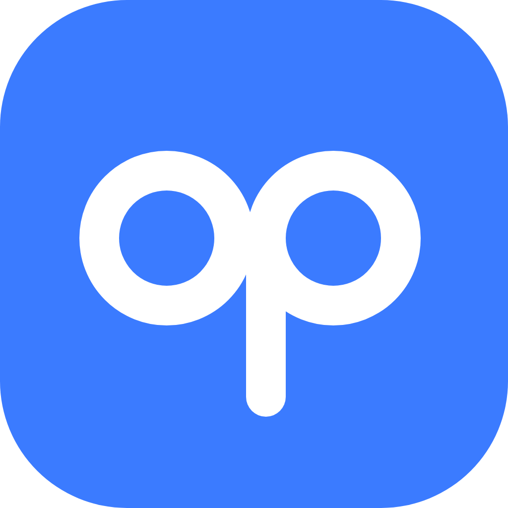

# OPPAPP

**The OPPortunities for APPlications APP.** It's out there. Find it here.

Internships, research, volunteering and more, matched to you. OPPAPP writes the emails and fills out the applications. You just hit send.

**Live app:** https://harshasingla18.github.io/OPPAPP/ · Built at **DubHacks '26** (Cook Smarter)

## The problem

Landing a first research spot or internship often depends on who you know. Students without connections spend hours digging through lab pages and job boards, guessing whether they're eligible, writing every email from scratch and tracking it all in a spreadsheet.

## What OPPAPP does

1. **Build your profile once.** Upload a résumé (PDF, DOCX or TXT). Gemini fills in your profile and shows the résumé line behind every item; anything it can't trace back to your résumé starts unchecked. Nothing is saved until you approve it.
2. **Discover opportunities.** Research programs, internships, open source, teams, competitions and volunteering, filterable by education level, arrangement, pay, skills and deadline. Real programs link to their official page; demo listings are labeled as fictional.
3. **Understand your fit.** Interest, eligibility, skills, location and deadline are checked separately. Gemini explains each requirement as **confirmed**, **possible**, **unknown** or a **gap**, and any point it can't back up with your profile is removed or downgraded. No made-up match percentages.
4. **Find the contact.** Gemini with Google Search looks for a published contact email and shows the page it came from. If no search result backs an address up, OPPAPP says **No email found** in red instead of guessing.
5. **Prepare applications.** Outreach and research-inquiry emails, statements of interest, experience summaries and form answers, written only from your profile. One click prepares several applications at once.
6. **Catch made-up claims.** Any statement in a draft that isn't in your profile (an award, a skill, a number) is flagged in red and blocks "I submitted this" until you edit it out or confirm it's true.
7. **Track everything.** Interested → In progress → Submitted → Interview → Accepted / Rejected / Withdrawn, with search, filters, notes, follow-up dates, and one-click export of deadlines to Google, Apple or Outlook Calendar.

OPPAPP never sends an email or submits an application for you. "Open in my email app" creates a draft you review and send yourself.

## Try it

1. Open the [live app](https://harshasingla18.github.io/OPPAPP/) and click **Get started**.
2. Click **Try demo student** (a fictional student) or upload your own résumé.
3. Optional: click **Turn on Gemini** and paste a free key from [aistudio.google.com/apikey](https://aistudio.google.com/apikey).
4. Open an opportunity → **Prepare Application** → **Draft with Gemini** → review → **My Applications**.

Without a Gemini key, everything still works using rule-based extraction, matching and profile-based templates.

## How it's built

- One static `index.html`: plain HTML, CSS and JavaScript, hosted on GitHub Pages
- **Google Gemini API** (structured JSON output) for résumé extraction, fit explanations and drafting, with automatic fallback across current models when one is busy
- **Gemini + Google Search grounding** for contact emails; an address is only accepted if a search result supports it
- **Grounding checks** in the browser: every AI claim must cite profile evidence, plus a scan for unsupported skills, awards, publications, grades and figures
- pdf.js and mammoth.js (loaded on demand) to read résumés in the browser
- localStorage for all data; an animated canvas network background

## Privacy

There's no OPPAPP server or account. Your profile, applications and Gemini key stay in your browser. When you use a Gemini feature, only the fields needed go directly from your browser to Google. Phone numbers and LinkedIn are never sent. "Delete all my data" on My Profile wipes everything.

## Limits

- The grounding checks are heuristics. They catch common invented claims but can miss a reworded one, so you should always read a draft before sending it.
- Real program summaries can go out of date; each links to its official page, and dates and rules marked unknown should be confirmed there.
- Demo listings are fictional organizations used to show the full workflow.
